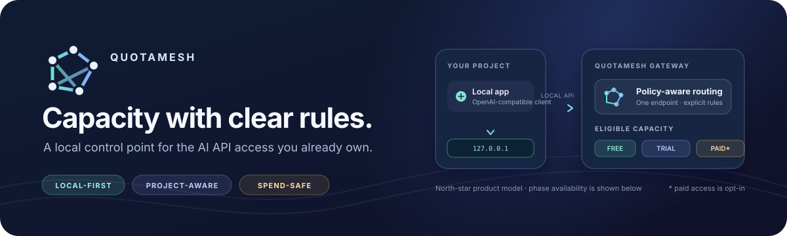
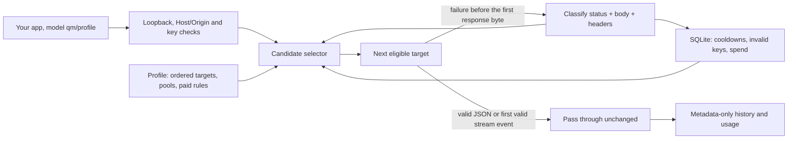

<div align="center">

# QuotaMesh



### One local endpoint for the AI API keys you already have

[Quick start](#quick-start-5-minutes) · [.env import](#import-keys-from-a-env-file) · [Routing](#how-routing-works) · [Paid guard](#paid-guard-caps-and-cost) · [Examples](examples/README.md) · [Troubleshooting](#troubleshooting) · [Development](#development-and-tests)

</div>

## In 60 seconds

QuotaMesh runs on your machine and gives every project the same OpenAI-compatible base
URL, `http://127.0.0.1:8787/v1`. Behind it you register the API keys you own (OpenAI,
Google Gemini, Groq, NVIDIA NIM and other OpenAI-compatible providers) and describe each
project as a **profile**: an ordered list of exact provider/model targets.

- Your app sends a normal Chat Completions request with `model: "qm/<profile>"`.
- QuotaMesh tries the profile's targets in order. If a target is rate limited, rejects
  its key, does not know the model or fails before the first response byte, the next
  target answers. Response headers and the Activity page show which one served it.
- Paid and unknown-plan keys stay **off** until a profile explicitly allows them, with
  optional local daily and monthly dollar caps.
- Everything is local: one process on loopback, SQLite, no telemetry. Prompts and replies
  are never stored; history holds metadata only.

QuotaMesh does not create quota, bypass provider limits or make paid calls free. It counts
only traffic that passes through it, so provider balances and remaining quota stay unknown.

## Quick start (5 minutes)

You need Python 3.11 or newer.

**1. Install.** With [uv](https://docs.astral.sh/uv/):

```sh
uv tool install quotamesh        # or run once without installing: uvx quotamesh start
```

or with pip (PowerShell shown first, then bash):

```powershell
python -m pip install quotamesh
```

```sh
python3 -m pip install quotamesh
```

> The PyPI release 0.1.0 predates the Get started page, the Playground, `.env` import and
> `quotamesh open` described below. Until the next release, install from a checkout:
> `python -m pip install -e .` in a clone of this repository.

**2. Start it.**

```sh
quotamesh start
```

It prints a one-time sign-in link and opens your browser. The link works once; if it was
already used or the browser lost the session, run `quotamesh open` for a fresh link.

**3. Get started page.** Paste the contents of your `.env` file (or add a single key).
QuotaMesh previews the variable names it recognizes, the provider and a suggested plan for
each key, and never shows the values. Confirm each plan: Gemini keys usually start as
FREE, OpenAI keys as PAID. Then pick a model from the key's model list. This saves the
`qm/default` profile with paid access off; no generation request is sent.

**4. Playground.** Send a prompt through `qm/default` exactly as an app would. The reply
comes with its route evidence: provider, model, attempts, fallback and tokens.

**5. Connect your app.** The Connect page prints the environment setup and a client
snippet for the selected profile (Python, Node, cURL or PowerShell, OpenCode). For example:

```powershell
$env:QUOTAMESH_BASE_URL = "http://127.0.0.1:8787/v1"
$env:QUOTAMESH_MODEL = "qm/default"
$env:QUOTAMESH_KEY = (quotamesh key | Out-String).Trim()
```

```sh
export QUOTAMESH_BASE_URL="http://127.0.0.1:8787/v1"
export QUOTAMESH_MODEL="qm/default"
export QUOTAMESH_KEY="$(quotamesh key)"
```

```python
import os
from openai import OpenAI

client = OpenAI(base_url=os.environ["QUOTAMESH_BASE_URL"],
                api_key=os.environ["QUOTAMESH_KEY"], max_retries=0)
reply = client.chat.completions.create(
    model=os.environ["QUOTAMESH_MODEL"],
    messages=[{"role": "user", "content": "Hello"}],
)
print(reply.choices[0].message.content)
```

`quotamesh key` prints the **local gateway key**. It only unlocks your local QuotaMesh;
provider keys never leave the server. Use `max_retries=0` so QuotaMesh, not the SDK,
decides about retries and fallback. The [examples](examples/README.md) show a streaming
chat, tool calling and JSON mode from a small "user project".

No keys yet? Run `quotamesh demo` for a fake-provider sandbox ([below](#try-it-without-keys)).

## Import keys from a .env file

QuotaMesh reads plain `NAME=value` lines (optional `export`, quotes and comments). It never
expands variables or runs anything, and files are limited to 64 KiB and 1000 lines.

| Recognized names | Provider | Suggested plan |
| --- | --- | --- |
| `OPENAI_API_KEY` | OpenAI | PAID |
| `GEMINI_API_KEY`, `GOOGLE_API_KEY` | Google Gemini | FREE |
| `GROQ_API_KEY` | Groq | FREE |
| `NVIDIA_API_KEY` | NVIDIA NIM | TRIAL_CREDIT |
| `ANTHROPIC_API_KEY`, `XAI_API_KEY`, `OPENROUTER_API_KEY`, `CEREBRAS_API_KEY`, `MISTRAL_API_KEY` | compatibility presets | UNKNOWN |

Add `_2`, `_3`, ... (for example `GEMINI_API_KEY_2`) for several keys of one provider.
Placeholders such as `your_key_here` are skipped, and a value repeated under another name
is reported as a duplicate. Suggestions are only suggestions: you confirm every plan, and
PAID or UNKNOWN keys still need a profile that allows paid use.

From the command line, against a running QuotaMesh:

```sh
quotamesh import-env --file .env                                   # preview, then confirm
quotamesh import-env --file .env --plan OPENAI_API_KEY=PAID --yes  # no prompt
quotamesh import-env --file .env --store reference                 # keep only variable names
```

`--store value` (the default) saves key values in the local database, like pasting a key
in the dashboard. `--store reference` saves only the variable name; the server process then
needs that variable, for example by starting it with `quotamesh start --env-file .env`.
Keys of one provider project share one quota; give keys from different projects
different quota groups in API access so one rate limit does not pause the others.
[`.env.example`](.env.example) is a template; `.env` is git-ignored.

## How routing works



- **Order is explicit.** Targets are tried in saved order; a target without a pinned key
  uses the provider's keys by ascending priority. Skips cost nothing; up to five upstream
  attempts per request by default.
- **Failures are classified.** A rejected or revoked key is marked INVALID; billing or
  account problems mark it unusable; 429 starts a cooldown shared by provider + quota
  group + model (Retry-After and documented reset headers win); an unknown model, 5xx or
  network failure blocks that provider/model briefly. Gemini's array-shaped error bodies
  are understood too. A malformed request (400/422) is returned to you as-is.
- **Streams commit once.** The first valid stream event commits the provider; errors
  before it fall back, interruptions after it end with an SSE error event and never switch
  provider. A stream ends normally at `data: [DONE]`, or at a clean close after a
  `finish_reason`. A stream silent for 60 seconds is ended with an error.
- **Deadlines.** New profiles allow 90 seconds for a non-stream request and 45 seconds for
  the first stream event, across all attempts; both are editable per profile.
- **Evidence.** Every response carries `X-QuotaMesh-Profile`, `-Provider`, `-Model`, `-Key`,
  `-Attempts`, `-Fallback` and `-Request-Id`. When every candidate is blocked, QuotaMesh
  answers 429 with Retry-After if one recovers within 60 seconds, otherwise 503, and lists
  each candidate's skip reason.

Requests and replies pass through unchanged apart from the `model` field. To account for
streamed tokens, QuotaMesh asks OpenAI and Gemini for stream usage when your client did
not; it then withholds OpenAI's extra usage-only chunk from that client and marks the
response with `X-QuotaMesh-Usage-Injected: true`.

## Paid guard, caps and cost

- PAID and UNKNOWN keys are skipped unless the profile allows paid use. When every target
  of a profile is such a key, the request fails with `403 paid_blocked` and **no provider
  call is made**.
- Optional daily and monthly caps (UTC) apply per profile to paid traffic through QuotaMesh.
  They check observed spend before each request, so concurrent requests can overshoot by
  their own cost. They are not provider billing limits; set those at the provider as well.
- No price list is bundled. Enter input and output USD prices per million tokens on a
  capped paid target; QuotaMesh estimates cost from the provider's usage. A provider's own
  `usage.cost_usd` wins. Missing usage keeps cost unknown, and a capped profile then blocks
  paid routing until you reconcile it (Profiles) or explicitly allow unknown prices.
- If paid accounting cannot be written, the finished response still reaches you, but paid
  routing fails closed until you repair storage and acknowledge it in the dashboard.

## Try it without keys

```sh
quotamesh demo
```

The demo runs on port **8788** with temporary data, a fake provider and simulated dollars;
it deletes its data on exit. Its dashboard has a scenario picker: rate limit with free
backup, shared quota groups, paid guard, a $1 daily cap, stream errors before and after the
first event, expired and rejected keys. It prints a `quotamesh key --data-dir ...` command
for its own local key, so the [examples](examples/README.md) can run against it.

## CLI reference

| Command | Purpose |
| --- | --- |
| `quotamesh start [--port 8787] [--no-browser] [--env-file .env]` | Run the dashboard and gateway; `--env-file` gives the server process that file's variables for environment references |
| `quotamesh open [--port] [--print]` | Open (or print) a fresh one-time dashboard link for the running server |
| `quotamesh key [--data-dir DIR]` | Print the local gateway key |
| `quotamesh import-env --file .env [--plan NAME=PLAN ...] [--store value\|reference] [--yes]` | Preview and import keys from a `.env` file |
| `quotamesh import-env [NAME ...]` | Import keys present in the server's own environment as references |
| `quotamesh add --provider P --plan PLAN [--env-name VAR]` | Add one key (prompts privately when no variable is given) |
| `quotamesh status` | Wallet and profile summary |
| `quotamesh profile test SLUG` | Dry-run a profile's route; no provider call |
| `quotamesh doctor ID [--generation --consent --profile SLUG --position N]` | List a key's models, or explicitly test one target |
| `quotamesh env SLUG [--shell bash\|powershell]` | Print client environment setup |
| `quotamesh reset ID` | Clear a key's invalid/cooldown state (never restores quota or spend) |
| `quotamesh tail` | Follow metadata-only activity |
| `quotamesh demo [--port 8788]` / `quotamesh fake-upstream` | Fake-provider sandbox / standalone fake provider |

Commands that talk to a running server accept `--port`. Set `QUOTAMESH_DATA_DIR` to use a
separate data directory.

## Local API

All endpoints are on `127.0.0.1`. Gateway endpoints need the local bearer key; management
endpoints accept the dashboard session or the bearer key unless noted. Errors use the
OpenAI shape `{"error": {"message", "type", "code"}}` and never contain provider secrets.

| Endpoint | Purpose |
| --- | --- |
| `POST /v1/chat/completions` | Routed Chat Completions, stream and non-stream |
| `GET /v1/models`, `GET /v1/models/{id}` | Enabled profile aliases (`qm/<slug>`) |
| `GET /health` | Process liveness only |
| `POST /api/session/link` | One-time dashboard link (bearer key only; used by `quotamesh open`) |
| `POST /api/local-key/reveal` | Show the local key in the dashboard (session only, not cached) |
| `POST /api/environment/parse`, `POST /api/environment/import-file` | Preview and import `.env` content; values are never returned |
| `GET /api/environment`, `POST /api/environment/import` | Import keys from the server's own environment |
| `POST /api/credentials`, `PATCH`/`DELETE /api/credentials/{id}`, `POST /api/credentials/{id}/action` | Manage keys (write-only secrets) |
| `POST /api/setup` | First-run `qm/default` from a saved key and model, paid off unless asked |
| `GET`/`POST /api/profiles`, `PUT`/`DELETE /api/profiles/{slug}` | Manage profiles |
| `POST /api/profiles/{slug}/reconcile` | Record a manual amount for unknown paid cost |
| `POST /api/accounting/acknowledge` | Re-enable paid routing after storage is repaired |
| `GET /api/explain`, `GET /api/dry-run`, `GET /api/status` | Candidate decisions with reasons and recovery links |
| `GET /api/wallet`, `GET /api/usage` | Grouped capacity, today's usage and a 14-day daily series |
| `GET /api/activity`, `GET /api/requests/{id}`, `GET /events` | Request traces and live metadata events |
| `POST /api/doctor`, `GET /api/doctor` | Explicit model listing or one-target generation check |
| `GET /api/integrations`, `GET /api/catalog` | Connection snippets; dated provider links |

## Data and privacy

- **Metadata only.** History stores timestamps, profile, key label, provider, model,
  outcome, HTTP status, latency, tokens and cost. Prompts, replies and authorization headers
  are never stored or logged. Traces are kept for 30 days or 50,000 attempts; daily usage
  totals are kept.
- **Secrets.** Keys saved by value are plaintext in the local SQLite database. The data
  directory is restricted to your user on macOS and Linux; on Windows it relies on your
  profile's default permissions. Saving keys as environment references keeps values out of
  the database.
- **Durability.** SQLite runs in WAL mode with `synchronous=NORMAL`: an application crash
  loses nothing, but a power loss or OS crash can drop the last moments of metadata
  (history, usage) without corrupting the database.
- **Location.** `%LOCALAPPDATA%\QuotaMesh` on Windows, `~/.local/share/quotamesh`
  elsewhere, or `QUOTAMESH_DATA_DIR`. One running QuotaMesh owns a data directory at a
  time. Back it up before upgrading; older builds cannot open a newer schema.

## Compatibility

- **API surface:** OpenAI Chat Completions (`/v1/chat/completions`, `/v1/models`), stream and
  non-stream, including tools and `response_format`. There is no Responses or Messages API,
  so Codex and Claude Code cannot use QuotaMesh natively. OpenCode can use it through its
  OpenAI-compatible provider (`@ai-sdk/openai-compatible`), which the Connect page
  configures; that transport is tested, the full OpenCode application is not.
- **Verified live (2026-10-16):** OpenAI (`gpt-4.1-nano`) and Gemini through Google's
  OpenAI-compatible endpoint (`gemini-3.5-flash-lite`); see
  [live provider notes](docs/live-provider-notes.md). Groq, NVIDIA NIM and the
  Anthropic, xAI, OpenRouter, Cerebras and Mistral presets use the same generic transport
  and are covered by synthetic tests only.
- **Gemini specifics:** new `AQ.` keys work. Tool calls arrive with `finish_reason: "stop"`,
  streamed tool calls carry no `index`, and Gemini 3 returns
  `extra_content.google.thought_signature`, which your app must send back unchanged with
  the assistant tool-call message ([example](examples/support_desk.py)). Non-stream replies
  can take 15-30 seconds.
- **OpenAI specifics:** GPT-5 models reject `max_tokens`; send `max_completion_tokens`.

## Troubleshooting

| Symptom | What to do |
| --- | --- |
| The sign-in link says it was already used, or the dashboard is locked | Run `quotamesh open` (add `--port` for a non-default port). |
| `401 unauthorized` from your app | Use the local key from `quotamesh key`, not a provider key; the demo has its own key. |
| `403 paid_blocked` | Every eligible key is PAID or UNKNOWN. Allow paid use for that profile (ideally with a cap), add a free target, or correct the key's plan. |
| `404 profile_not_found` | Use `qm/<slug>` of a saved, enabled profile; `GET /v1/models` lists them. |
| `429` | With code `no_candidates`, QuotaMesh is waiting for a cooldown that ends within a minute (see Retry-After). Otherwise the provider's own 429 passed through after the other targets were tried. |
| `503` | With code `no_candidates`, nothing is eligible: the body lists each target's skip reason and the Route page explains it. An upstream 503 (for example Gemini "high demand") means the provider is overloaded: retry, use streaming, or add a backup target. |
| `504 deadline_exceeded` | No target answered in the profile's deadline. Gemini non-stream calls are slow; stream instead, or raise the deadline in Profiles. |
| `400` from the provider | The request itself was rejected (for example `max_tokens` on GPT-5 models); it is returned unchanged and is not retried. |
| A key shows INVALID | The provider rejected it. Rotate it in API access, or run Doctor and then `quotamesh reset ID` if it was a transient mistake. |

## Development and tests

From a clone (Windows paths first, then bash):

```powershell
python -m venv .venv
.venv\Scripts\python.exe -m pip install -e ".[dev]"
# if the venv has no pip: uv pip install --python .venv\Scripts\python.exe -e ".[dev]"
.venv\Scripts\ruff.exe check .
.venv\Scripts\python.exe -m pytest -q
.venv\Scripts\python.exe -m build
```

```sh
python3 -m venv .venv
.venv/bin/python -m pip install -e '.[dev]'
.venv/bin/ruff check .
.venv/bin/pytest -q
.venv/bin/python -m build
```

- **Unit and integration tests** use fake providers only; an autouse guard blocks any
  non-loopback connection in ordinary tests.
- **Browser smoke** (Playwright Chromium, optional): `pip install -e ".[browser]"`,
  `playwright install chromium`, then `python scripts/browser_smoke.py --screenshots
  output/frontend-browser`. It runs its own isolated demo.
- **Benchmark:** `python scripts/bench_gateway.py --requests 500 --concurrency 20` measures
  gateway overhead against an in-process fake provider (no network).
- **Live suite (opt-in, real providers).** Put your keys in `.env` (never commit it), then
  run `python -m pytest -m live tests/live -q --tb=short`. It is deselected by default. It
  saves keys only as environment references in temporary data directories, caps every
  request's tokens, spaces Gemini calls five seconds apart and stops at a per-run budget of
  chat calls (`QM_LIVE_MAX_OPENAI`, default 40; `QM_LIVE_MAX_GEMINI`, default 30). A full
  run makes about 8 OpenAI and 6 Gemini chat calls (two of the Gemini calls are rejected
  on purpose): well under $0.01 with `gpt-4.1-nano`, and nothing on Gemini's free tier.
  Override models with `QM_LIVE_OPENAI_MODEL` and `QM_LIVE_GEMINI_MODEL`, or the `.env`
  location with `QM_ENV_FILE`. On an OpenAI billing error or a Gemini 429/503 the suite
  checks how QuotaMesh classified it, then skips that provider's remaining tests. The
  stories it proves are listed in [docs/user-stories.md](docs/user-stories.md).

Contributions use task branches and Conventional Commits; see [CONTRIBUTING.md](CONTRIBUTING.md)
and [AGENTS.md](AGENTS.md). Design and scope: [architecture](docs/architecture.md),
[roadmap](ROADMAP.md), [testing guide](docs/final-testing-guide.md),
[release evidence](docs/release-evidence.md) and the
[product spec](QuotaMesh_MVP_Architecture_Product_Spec_v0.3.pdf). Licensed under MIT.
